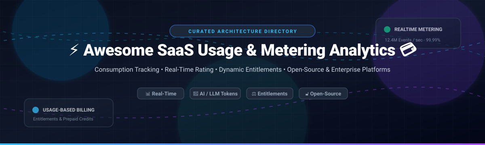

# ⚡ Awesome SaaS Usage & Metering Analytics 💳

  <strong>A curated list of top-tier SaaS Usage & Metering Analytics platforms, event rating engines, billing middleware, and open-source infrastructure for real-time consumption billing and entitlement enforcement.</strong>

  <em>Track high-throughput events, meter AI & LLM token usage, automate subscription allowances, handle prepaid credit wallets, and power hybrid usage-based monetization models.</em>

---

## 📑 Table of Contents

- [🌐 Sector Overview & Market Dynamics](#-sector-overview--market-dynamics)
- [🟦 SaaS / Hosted Platforms](#-saas--hosted-platforms)
- [🟩 Open-Source Software](#-open-source-software)
- [📊 Comparison at a Glance](#-comparison-at-a-glance)
- [📈 Star History](#-star-history)
- [💖 Support & Sponsorship](#-support--sponsorship)
- [🤝 Contributing](#-contributing)
- [📄 License](#-license)

---

## 🌐 Sector Overview & Market Dynamics

The global usage-based billing and subscription management market is estimated between **$6.8B and $8.5B in 2025–2026**, expanding rapidly at an estimated compound annual growth rate (CAGR) of **16% to 20%** driven by generative AI tokens, API consumption, and compute-heavy architectures. 

The sector has evolved into a **moderately fragmented and rapidly consolidating** landscape where hyper-scale payment and enterprise cloud ecosystems (such as Stripe's acquisition of Metronome, Salesforce's acquisition of m3ter, and Adyen's $335M buyout of Orb) dominate enterprise financial infrastructure, while agile independent and open-source platforms vigorously capture developers needing transparent, real-time event aggregation and lock-in-free metering engines.

---

## 🟦 SaaS / Hosted Platforms

Below is an overview of commercial, cloud-hosted SaaS Usage and Metering Analytics platforms, ranked in descending order of vendor scale (company valuation and annual revenue).

| Solution | Vendor Scale (Valuation / Revenue) | Key Focus & Metering Capabilities | Starting Tier Pricing | Free Tier Limits / Free Trial |
| :--- | :--- | :--- | :--- | :--- |
| **[m3ter (Salesforce)](https://www.m3ter.com/)** | **~$280B+ Market Cap** (Parent: Salesforce) | High-volume usage ingestion and rating middleware bridging telemetry directly with Salesforce CRM, CPQ, and ERP billing ledgers. | **$1,500/month** base core platform fee (plus add-on packages for ERP connectors). | **No free tier**; structured 30-day guided enterprise Proof-of-Concept (PoC) with demo sandboxes. |
| **[Metronome (Stripe)](https://metronome.com/)** | **~$70B+ Valuation** (Parent: Stripe) | High-throughput event ingestion, real-time SQL rating, and native Stripe billing synchronization for usage-based and commit contracts. | **Starter Plan: $0 base** + 0.8% of metered billing volume and ~$0.04 per 1k rated events; Custom Enterprise contracts. | **Free Starter Tier**: Free forever for early-stage teams with core real-time event streaming and basic SQL rating rules. |
| **[Orb (Adyen)](https://withorb.com/)** | **~$45B+ Market Cap** (Parent: Adyen; acquired for $335M) | Multi-dimensional dynamic rating, real-time credit drawdowns, customer usage alerts, and granular invoice line-item generation. | **$1,200/month** base fee + tier-based percentage of metered usage volume. | **No free tier**; 14-day free developer sandbox and guided staging environment trial. |
| **[Zuora](https://www.zuora.com/)** | **~$1.5B Market Cap** (Acquired Togai) | Enterprise monetization suite powering subscription lifecycles, automated revenue recognition (ASC 606), and Togai visual usage rating. | **$1,000/month** (Zuora Grow / starter enterprise contracts quoted annually). | **No free tier**; custom 30-day enterprise sandbox trial available upon sales qualification. |
| **[Chargebee](https://www.chargebee.com/)** | **~$3.5B Valuation** | Comprehensive subscription management, automated invoice-to-cash workflows, dunning pipelines, and metered usage add-on modules. | **$599/month** (Performance Tier, billed annually) for up to $100k/mo processing volume + 0.75% overage. | **Free Starter Plan**: $0/mo for early startups up to first $250,000 in cumulative processed billing; plus 14-day full-feature trial. |
| **[Amberflo](https://www.amberflo.io/)** | **Independent Venture-Backed** (~$15M–$20M Series A) | Corporately independent real-time cloud and AI token metering platform with cost attribution, rate cards, and automated billing. | **$99/month** (Startup Plan) covering initial usage-tier event volume. | **Free Forever Tier**: Free up to 1,000,000 ingested events per month with complete API access; plus 30-day Pro trial. |

---

## 🟩 Open-Source Software

Curated open-source software platforms providing transparent, self-hosted usage metering engines, real-time rate tracking, entitlement validation, and billing pipelines. Ranked by GitHub_Stars in descending order.

| Project | License | Tech Stack | GitHub_Stars | Core Capabilities |
| :--- | :--- | :--- | :---: | :--- |
| **[Lago](https://github.com/getlago/lago)** | `AGPL-3.0` | Ruby, PostgreSQL, Redis, ClickHouse |  | Comprehensive open-source metering and billing API engine. Supports 7 event aggregation modes (COUNT, SUM, MAX, LATEST, etc.), late-arriving event processing, transaction deduplication, and prepaid wallet credits. |
| **[Flexprice](https://github.com/flexprice/flexprice)** | `AGPL-3.0` | Go, TypeScript, PostgreSQL, Docker |  | Developer-friendly usage-based pricing and billing framework. Features low-latency event ingestion, instant credit management, feature access gates, MCP server for AI agent billing, and a modern dashboard. |
| **[Kill Bill](https://github.com/killbill/killbill)** | `Apache-2.0` | Java, MySQL/PostgreSQL |  | Battle-tested, enterprise-grade open-source billing and payment orchestration platform. Powers subscription lifecycles, custom payment gateways, hierarchical accounts, and high-volume invoice generation. |
| **[OpenMeter](https://github.com/openmeterio/openmeter)** | `Apache-2.0` | Go, ClickHouse, Kafka |  | Cloud-native, high-frequency usage metering built for AI agents, APIs, and DevOps workloads. Powered by ClickHouse and Kafka for sub-second balance queries, prepaid credit burn-down, and LLM token tracking. |
| **[Lotus](https://github.com/uselotus/lotus)** | `MIT` | Python, Django, React, Docker |  | Open-source pricing and packaging infrastructure. Allows teams to deploy subscription and usage-based tiers, run A/B pricing experiments, and track metrics with automated customer usage alerts. |
| **[Meteroid](https://github.com/meteroid-oss/meteroid)** | `Apache-2.0` | TypeScript, Node.js, ClickHouse |  | Open-source consumption metering and usage billing framework designed for quick setup, subscription handling, automated invoicing, customer usage caps, and revenue analytics. |
| **[Tier](https://github.com/tierrun/tier)** | `Apache-2.0` | Go, Stripe API |  | Lightweight SDK and CLI that turns Stripe into an entitlement and usage-based metering engine using JSON pricing schemas defined in code (`pricing.json`). |

---

## 📊 Comparison at a Glance

| Solution | Deployment | License / Model | Real-Time Metering | Prepaid Credits | AI & LLM Token Tracking | Self-Hosted | Primary Strength |
| :--- | :--- | :--- | :---: | :---: | :---: | :---: | :--- |
| **m3ter (Salesforce)** | Cloud SaaS | Commercial | ✅ High-throughput | ✅ | ⚠️ Via events | ❌ | Salesforce CRM / ERP enterprise sync |
| **Metronome (Stripe)** | Cloud SaaS | Commercial | ✅ High-throughput | ✅ | ✅ Supported | ❌ | Stripe-native rating engine |
| **Orb (Adyen)** | Cloud SaaS | Commercial | ✅ Real-time | ✅ | ✅ Supported | ❌ | Multi-dimensional billing & line items |
| **Zuora** | Cloud SaaS | Commercial | ✅ Via Togai | ✅ | ⚠️ Via events | ❌ | Global enterprise monetization & ASC 606 |
| **Chargebee** | Cloud SaaS | Commercial | ⚠️ Add-on | ✅ | ⚠️ Via events | ❌ | Subscription billing & dunning |
| **Amberflo** | Cloud SaaS | Commercial | ✅ Event-first | ✅ | ✅ First-class | ❌ | Independent metering & AI cost governance |
| **Lago** | Self-Hosted / Cloud | AGPL-3.0 | ✅ Real-time | ✅ | ✅ Via metrics | ✅ | Mature full-lifecycle open-source billing |
| **Flexprice** | Self-Hosted / Cloud | AGPL-3.0 | ✅ Real-time | ✅ | ✅ First-class | ✅ | Developer-first UI, Go stack & AI MCP |
| **Kill Bill** | Self-Hosted | Apache-2.0 | ✅ Ingestion | ✅ | ⚠️ Custom plugin | ✅ | Enterprise modular billing & payments |
| **OpenMeter** | Self-Hosted / Cloud | Apache-2.0 | ✅ Sub-second | ✅ Burn-down | ✅ First-class | ✅ | Ultra-scalable ClickHouse & Kafka engine |
| **Lotus** | Self-Hosted | MIT | ✅ Real-time | ⚠️ | ⚠️ Basic | ✅ | Pricing experimentations & packaging UI |
| **Meteroid** | Self-Hosted | Apache-2.0 | ✅ Real-time | ✅ | ⚠️ Via events | ✅ | Lightweight ClickHouse-backed analytics |
| **Tier** | Self-Hosted / CLI | Apache-2.0 | ✅ Via Stripe | ⚠️ | ⚠️ Via events | ✅ | Minimalist code-defined Stripe tiers |

---

## 📈 Star History

---

## 💖 Support & Sponsorship

If this curated directory has helped you discover architectures, evaluate usage-based billing infrastructure, or save engineering hours, please consider showing your support:

- 🌟 **Star this repository** on GitHub to help others discover it!
- 🍴 **Fork and contribute** your favorite tools and insights.
- 📢 **Share this repo** on Twitter/X, LinkedIn, Reddit, or developer Discord communities.
- ☕ **Buy a coffee or become a sponsor**: Support ongoing open-source maintenance and research directly via the [GitHub Sponsors Dashboard](https://github.com/sponsors/ishandutta2007).

---

## 🤝 Contributing

Contributions are warmly encouraged! To propose a tool, update pricing models, or suggest architectural additions:

1. 🍴 Fork this repository.
2. 🌿 Create a descriptive feature branch (`git checkout -b feature/add-new-metering-tool`).
3. ✍️ Add the project following our tabular format with concrete pricing, verifiable free tiers/trials, and active license details.
4. 🚀 Open a well-documented Pull Request.

---

## 📄 License

This repository and curated list are made available under the [Creative Commons Zero v1.0 Universal](LICENSE) (CC0 1.0) Public Domain Dedication. All listed products and registered trademarks are properties of their respective owners.
